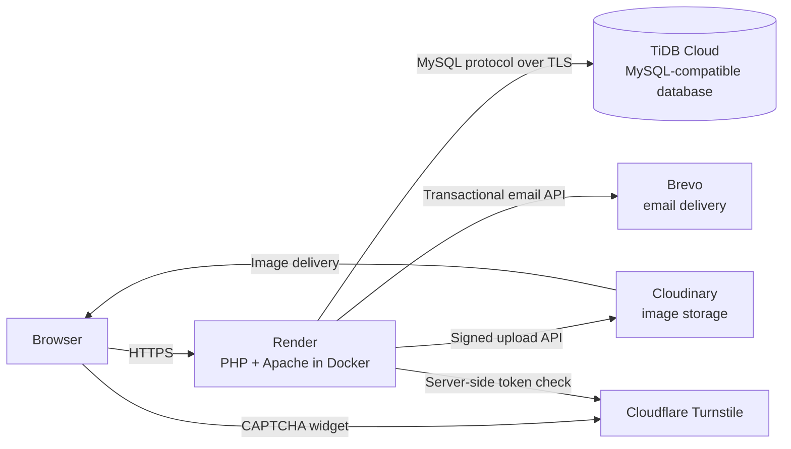
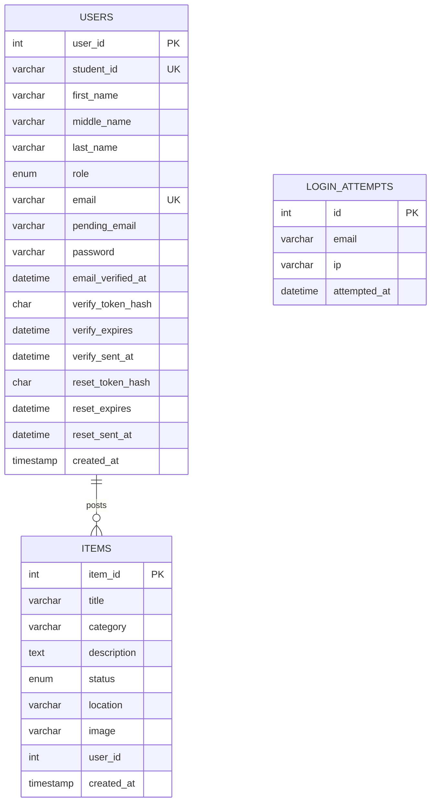

# Campus Lost and Found System

> A secure, web-based platform that allows students to report, search for and recover lost and found items on a university campus.

| | |
|---|---|
| **Author** | Alfred Owatarite Ayeba-Enenimiete |
| **Institution** | Nile University |
| **Course** | SEN100, Software Engineering |
| **Date** | November 2026 |
| **Live application** | https://campus-lost-and-found-mpua.onrender.com |
| **Source code** | https://github.com/alfredayeba-dev/campus-lost-and-found |
| **Status** | Complete and deployed |

---

## Table of Contents

1. [Overview](#1-overview)
2. [Objectives](#2-objectives)
3. [Features](#3-features)
4. [System Architecture](#4-system-architecture)
5. [Technology Stack](#5-technology-stack)
6. [Database Design](#6-database-design)
7. [Project Structure](#7-project-structure)
8. [Page Reference](#8-page-reference)
9. [Security Measures](#9-security-measures)
10. [Local Installation](#10-local-installation)
11. [Configuration](#11-configuration)
12. [Deployment](#12-deployment)
13. [Testing](#13-testing)
14. [Screenshots](#14-screenshots)
15. [Limitations and Future Work](#15-limitations-and-future-work)
16. [Third-Party Services, Libraries and Credits](#16-third-party-services-libraries-and-credits)
17. [Use of Artificial Intelligence](#17-use-of-artificial-intelligence)
18. [Licence](#18-licence)

---

## 1. Overview

Lost property on a campus is usually handled through notice boards, group chats and word of mouth. These methods are scattered, easy to miss and impossible to search. The **Campus Lost and Found System** replaces them with a single web application where students can post a report for an item they have lost or found, attach a photograph, search all open reports, and contact the person who posted an item. Administrators can moderate content and manage user accounts.

The application is written in PHP with a MySQL-compatible database and no front-end framework. It places particular emphasis on **secure account handling**: email verification, CAPTCHA protection, brute-force rate limiting, CSRF protection, hashed tokens and hardened sessions.

## 2. Objectives

1. Provide a central, searchable register of lost and found items.
2. Allow only verified students to post, so that contact details are trustworthy.
3. Let owners manage the lifecycle of their reports (edit, mark as returned or claimed, delete).
4. Give administrators the tools to moderate items and users.
5. Apply recognised web-security practices appropriate to an application that stores personal data.
6. Deploy the system to a public host using only free-tier cloud services.

## 3. Features

### 3.1 For students

| Area | Description |
|---|---|
| **Registration** | Student ID, name, email and password. Duplicate emails and student IDs are rejected. |
| **Email verification** | A time-limited link is emailed on registration. Login is refused until the address is verified. |
| **Login** | CAPTCHA-protected login with rate limiting and a generic error message. |
| **Password reset** | Emailed one-hour, single-use link. |
| **Dashboard** | Live counters (total, lost, found, returned, claimed) and the three most recent reports. |
| **Report lost / found item** | Title, category, description, location and an optional photograph (JPG, PNG or GIF, up to 2 MB). |
| **Browse and search** | Search by title, description or location; filter by status. |
| **Item detail page** | Full details, photograph, poster information and a "Contact poster" email link. |
| **My Posts** | View, edit, delete, and mark a post as *returned* (lost items) or *claimed* (found items). |
| **Profile** | Edit name and email, and change password. A changed email must be re-verified before it takes effect. |

### 3.2 For administrators

| Area | Description |
|---|---|
| **Overview** | Counts of users, administrators and items by status. |
| **Manage items** | Search, filter, change the status of, and delete any item (including its stored photograph). |
| **Manage users** | Search users, promote or demote between *student* and *admin*, and delete a user together with their posts. |
| **Safeguards** | Admin status is re-checked against the database on every request; administrators cannot modify or delete their own account from the user page. |

### 3.3 Item lifecycle

```
lost  ──► returned
found ──► claimed
```

## 4. System Architecture



The application follows a simple page-controller structure. Each PHP page handles its own request, includes shared helpers from `includes/`, and renders HTML using a common stylesheet. Configuration is read from environment variables so that identical code runs on a local XAMPP installation and on the production host.

## 5. Technology Stack

| Layer | Technology |
|---|---|
| Language | PHP 8.2+ (developed on 8.2, production container on 8.3) |
| Web server | Apache 2.4 |
| Database | MariaDB/MySQL locally; TiDB Cloud (MySQL-compatible) in production |
| Database access | `mysqli` with prepared statements |
| Front end | HTML5 and CSS3 (no framework); typeface *Baloo 2* from Google Fonts |
| CAPTCHA | Cloudflare Turnstile |
| Email | Brevo transactional email API (PHPMailer SMTP and a log-file mode are available as fallbacks) |
| Image storage | Cloudinary (signed uploads); local `uploads/` folder as a development fallback |
| Hosting | Render (Docker web service) |
| Version control | Git and GitHub |

## 6. Database Design

### 6.1 Entity relationship



The relationship between `items.user_id` and `users.user_id` is maintained by application logic (for example, deleting a user first deletes that user's items).

### 6.2 Data dictionary

**`users`**

| Column | Type | Notes |
|---|---|---|
| `user_id` | INT, PK, auto-increment | |
| `student_id` | VARCHAR(50), unique | |
| `first_name`, `last_name` | VARCHAR(50), required | |
| `middle_name` | VARCHAR(50), nullable | Optional |
| `role` | ENUM(`student`,`admin`) | Default `student` |
| `email` | VARCHAR(100), unique | Login identifier |
| `pending_email` | VARCHAR(100), nullable | New address awaiting verification |
| `password` | VARCHAR(255) | `password_hash()` output (bcrypt) |
| `email_verified_at` | DATETIME, nullable | `NULL` means unverified |
| `verify_token_hash`, `verify_expires`, `verify_sent_at` | CHAR(64), DATETIME, DATETIME | SHA-256 hash of the emailed token, its expiry (24 h), and the last send time (60 s cooldown) |
| `reset_token_hash`, `reset_expires`, `reset_sent_at` | CHAR(64), DATETIME, DATETIME | Same pattern for password reset (1 h expiry) |
| `created_at` | TIMESTAMP | |

**`items`**

| Column | Type | Notes |
|---|---|---|
| `item_id` | INT, PK, auto-increment | |
| `title` | VARCHAR(150) | |
| `category` | VARCHAR(100) | Chosen from a fixed list |
| `description` | TEXT | Optional |
| `status` | ENUM(`lost`,`found`,`claimed`,`returned`) | Default `lost` |
| `location` | VARCHAR(255) | Where the item was lost or found |
| `image` | VARCHAR(255) | Cloudinary URL (production) or local filename (development) |
| `user_id` | INT, indexed | Owner of the post |
| `created_at` | TIMESTAMP | |

**`login_attempts`**

| Column | Type | Notes |
|---|---|---|
| `id` | INT, PK, auto-increment | |
| `email` | VARCHAR(100) | Normalised to lower case |
| `ip` | VARCHAR(45) | IPv4 or IPv6 |
| `attempted_at` | DATETIME | Indexed with `ip` and with `email` |

The complete, importable definition is in [`schema.sql`](schema.sql). It contains structure only and no data.

## 7. Project Structure

```
campus-lost-found/
├── config/
│   └── database.php            Database connection (reads environment variables)
├── css/
│   └── style.css               Single shared stylesheet
├── images/
│   └── map-icon.png            Dashboard illustration
├── includes/
│   ├── env.php                 Reads settings from the environment or .env
│   ├── security.php            Secure session start, idle timeout, CSRF helpers
│   ├── captcha.php             Cloudflare Turnstile widget and server-side check
│   ├── ratelimit.php           Login attempt limiter
│   ├── mailer.php              Email sending (Brevo API / SMTP / log file)
│   ├── verification.php        Email-verification token creation
│   ├── password-reset.php      Password-reset token creation
│   ├── images.php              Image upload, URL and delete helpers
│   ├── report-item-form.php    Shared form for lost and found reports
│   ├── admin-guard.php         Admin access check
│   ├── admin-nav.php           Admin navigation
│   └── phpmailer/              PHPMailer library files
├── uploads/                    Local development uploads (protected by .htaccess)
├── dashboard.php
├── login.php
├── register.php
├── logout.php
├── verify-email.php
├── resend-verification.php
├── forgot-password.php
├── reset-password.php
├── profile.php
├── report-lost-item.php
├── report-found-item.php
├── view-items.php
├── view-item.php
├── my-items.php
├── edit-item.php
├── admin.php
├── admin-items.php
├── admin-users.php
├── schema.sql                  Database structure
├── Dockerfile                  Production container definition
├── .dockerignore
├── .htaccess                   Blocks access to hidden and private files
├── .env.example                Template of required settings
├── README.md
└── AI_USE.md                   Statement on the use of AI
```

## 8. Page Reference

| Page | Access | Purpose |
|---|---|---|
| `register.php` | Public | Create an account |
| `verify-email.php` | Public (token link) | Confirm an email address |
| `resend-verification.php` | Public | Request a new verification link |
| `login.php` | Public | Sign in |
| `forgot-password.php` | Public | Request a password-reset link |
| `reset-password.php` | Public (token link) | Choose a new password |
| `dashboard.php` | Logged in | Overview and recent reports |
| `report-lost-item.php`, `report-found-item.php` | Logged in | Submit a report |
| `view-items.php` | Logged in | Search and filter all items |
| `view-item.php?id=` | Logged in | Single item detail |
| `my-items.php` | Logged in | Manage own posts |
| `edit-item.php?id=` | Logged in (owner) | Edit own post |
| `profile.php` | Logged in | Edit profile and change password |
| `logout.php` | Logged in | End the session |
| `admin.php`, `admin-items.php`, `admin-users.php` | Administrators only | Moderation and user management |

## 9. Security Measures

| Threat | Countermeasure |
|---|---|
| **SQL injection** | All queries use `mysqli` prepared statements with bound parameters. |
| **Cross-site scripting (XSS)** | All user-supplied output is escaped with `htmlspecialchars()`. |
| **Cross-site request forgery (CSRF)** | A 256-bit per-session token is embedded in every form and verified with `hash_equals()`. Requests without a valid token receive HTTP 419. Session cookies also use `SameSite=Lax`. |
| **Credential theft from the database** | Passwords are stored with `password_hash()` (bcrypt). Verification and reset tokens are 256-bit random values stored only as SHA-256 hashes. |
| **Brute-force and bot attacks** | Cloudflare Turnstile on login, register and recovery forms, plus a rate limiter (5 failures per account and IP, or 20 per IP, within 15 minutes). |
| **Account enumeration** | Login returns one generic error for unknown email and wrong password. Resend and reset forms give the same response whether or not the account exists. |
| **Session hijacking and fixation** | `HttpOnly`, `Secure` (on HTTPS) and `SameSite` cookie flags; session ID regenerated on login and password change; 30-minute idle timeout. |
| **Email address abuse** | Registration requires verification; changing email requires verification of the new address; resend actions have a 60-second cooldown. |
| **Malicious file upload** | Size limit (2 MB), MIME-type whitelist checked with `finfo` (not the file extension), randomised filenames, and storage on Cloudinary. The local `uploads/` folder denies script execution and directory listing. |
| **Broken access control** | Ownership is enforced in the SQL (`AND user_id = ?`), not only by hiding buttons. Admin role is re-read from the database on every admin request. |
| **Secret leakage** | Credentials are supplied by environment variables. `.env` is excluded from Git and from the Docker image, and is blocked from web access by `.htaccess`. |
| **Information disclosure** | Production PHP settings hide errors from visitors; details are written to server logs. Private folders (`includes/`, `config/`) deny direct web access. |
| **Transport security** | HTTPS on the host; TLS for the database connection. |

## 10. Local Installation

**Requirements:** XAMPP (or any Apache + PHP 8.2+ + MySQL/MariaDB stack) and Git.

1. Clone the repository into the web root:
   ```bash
   cd C:\xampp\htdocs
   git clone https://github.com/alfredayeba-dev/campus-lost-and-found.git campus-lost-found
   ```
2. Start **Apache** and **MySQL** in the XAMPP control panel.
3. In phpMyAdmin, create a database named `campus_lost_found` and import `schema.sql`.
4. Copy `.env.example` to `.env` and fill in the values (see [Configuration](#11-configuration)). With no email settings, verification and reset emails are written to `logs/mail.log` so the flow can be tested without an email account.
5. Open `http://localhost/campus-lost-found/register.php` and create an account.
6. Promote the first account to administrator in phpMyAdmin:
   ```sql
   UPDATE users SET role = 'admin' WHERE email = 'you@example.com';
   ```

If the database connection fails with a certificate error on Windows, set `DB_CA` in `.env` to the path of a CA bundle such as `C:/xampp/cacert.pem`.

## 11. Configuration

Settings are read first from real environment variables and then from a local `.env` file. Never commit `.env`.

| Variable | Purpose | Example |
|---|---|---|
| `APP_URL` | Public base URL, used to build links in emails | `https://your-service-name.onrender.com` |
| `DB_HOST` | Database host | `localhost` |
| `DB_PORT` | Database port | `3306` (TiDB Cloud: `4000`) |
| `DB_USER` | Database user | `root` |
| `DB_PASS` | Database password | |
| `DB_NAME` | Database name | `campus_lost_found` |
| `DB_SSL` | `1` to require TLS (cloud databases) | `0` |
| `DB_CA` | Optional path to a CA bundle | `C:/xampp/cacert.pem` |
| `TURNSTILE_SITE_KEY` | Public Turnstile key | |
| `TURNSTILE_SECRET_KEY` | Private Turnstile key | |
| `BREVO_API_KEY` | Brevo API key (enables API email mode) | |
| `MAIL_FROM` | Verified sender address (must match Brevo) | `noreply@example.com` |
| `MAIL_FROM_NAME` | Sender display name | `Campus Lost and Found` |
| `MAIL_HOST`, `MAIL_PORT`, `MAIL_USER`, `MAIL_PASS` | Optional SMTP fallback (not usable on Render's free tier) | |
| `CLOUDINARY_CLOUD_NAME`, `CLOUDINARY_API_KEY`, `CLOUDINARY_API_SECRET` | Image storage (local fallback if unset) | |
| `TRUST_PROXY` | `1` when behind a hosting proxy, so the real client IP is used by the rate limiter | `0` |

**Email mode** is chosen automatically: Brevo API if `BREVO_API_KEY` is set; otherwise SMTP if `MAIL_USER` and `MAIL_PASS` are set; otherwise a log file.

## 12. Deployment

The production system uses free-tier services:

| Component | Service | Reason |
|---|---|---|
| Application | **Render** (Docker web service) | Runs PHP and Apache from the repository's `Dockerfile`; redeploys on every push to `main`. |
| Database | **TiDB Cloud** | MySQL-compatible; Render's free tier does not provide MySQL. |
| Images | **Cloudinary** | Render's free-tier disk is erased on every restart. |
| Email | **Brevo** (HTTPS API) | Render's free tier blocks outbound SMTP ports. |
| CAPTCHA | **Cloudflare Turnstile** | Bot protection on public forms. |

**Procedure**

1. Create the TiDB database and run `schema.sql` in its SQL editor.
2. Create Cloudinary, Brevo (with a verified sender and a restricted API key) and Turnstile accounts.
3. Push the repository to GitHub.
4. On Render, create a **Web Service** from the repository with the **Docker** runtime and the free instance type.
5. Add every variable from [Configuration](#11-configuration) in Render's environment settings, including `TRUST_PROXY=1` and `DB_SSL=1`.
6. Add the Render hostname to the Turnstile widget's allowed hostnames and set `APP_URL` to the exact public URL.
7. Register an account and promote it to administrator with an `UPDATE` statement in TiDB.

## 13. Testing

Testing was performed manually by the author against both the local environment and the deployed application.

| # | Test case | Expected result | Result |
|---|---|---|---|
| 1 | Register with valid details | Account created; verification email sent; redirect to login with notice | Pass |
| 2 | Register with an existing email or student ID | Rejected with a clear message | Pass |
| 3 | Submit a form without a CAPTCHA token | Rejected | Pass |
| 4 | Log in before verifying the email | Refused; link to resend offered | Pass |
| 5 | Open a verification link (valid, reused, expired) | Valid link verifies; reused and expired links refused | Pass |
| 6 | Log in with correct credentials | Dashboard shown; cookie flags `HttpOnly`, `SameSite` and (on HTTPS) `Secure` present | Pass |
| 7 | Five failed logins for one account | Lockout message for about 15 minutes; other accounts unaffected | Pass |
| 8 | Password reset | Link works once; old password rejected; same response for unknown emails | Pass |
| 9 | Report an item with a photograph | Photo stored on Cloudinary; still present after a redeploy | Pass |
| 10 | Search and status filter | Correct results; reset restores full list | Pass |
| 11 | My Posts: edit, mark returned or claimed, delete | Status and counters update; photo removed from storage on delete | Pass |
| 12 | Modify another user's post | Refused by the server | Pass |
| 13 | Submit a form with the CSRF token removed | HTTP 419 "invalid or expired form" | Pass |
| 14 | Open admin pages as a student | HTTP 403 "access denied" | Pass |
| 15 | Admin: change status, delete item, promote or demote user, delete user | Actions succeed; own account protected | Pass |
| 16 | Profile: change name, email and password | Name updates at once; new email takes effect only after verification; password change requires the current password | Pass |
| 17 | Request `/.env`, `/includes/`, `/config/`, `/schema.sql` directly | Access denied | Pass |
| 18 | Remain idle past the timeout | Redirected to login with an "inactive" notice | Pass |

## 14. Screenshots

Add images to `docs/screenshots/` and reference them here.

| Screen | File |
|---|---|
| Login | `docs/screenshots/login.png` |
| Registration | `docs/screenshots/register.png` |
| Dashboard | `docs/screenshots/dashboard.png` |
| Report an item | `docs/screenshots/report.png` |
| All items (search and filter) | `docs/screenshots/items.png` |
| Item detail | `docs/screenshots/item-detail.png` |
| My Posts | `docs/screenshots/my-posts.png` |
| Profile | `docs/screenshots/profile.png` |
| Admin overview | `docs/screenshots/admin.png` |

Example of embedding: ``

## 15. Limitations and Future Work

### Known limitations

- **Sessions are stored on the container's disk.** On the free hosting tier, users are signed out when the instance sleeps after inactivity or is redeployed.
- **Cold starts.** The free instance sleeps after about 15 minutes without traffic, so the first request afterwards can take up to a minute.
- **Password reset does not end other active sessions** on other devices.
- **No pagination** on the item list; very large datasets would load slowly.
- **Contact is by email link only.** There is no in-app messaging or notification.
- **No automated test suite.** Verification was manual.
- **The user-item relationship is not enforced by a foreign key,** only by application logic.
- **Free-tier quotas** on email, image storage and the database apply, and the email API key expires after a period of inactivity.

### Planned improvements

1. Store sessions in the database so logins survive restarts.
2. A claim-request workflow in which a claimant submits proof and the poster approves or rejects.
3. In-app notifications and email alerts for claims.
4. Pagination and a category filter on the item list.
5. An audit log of administrator actions.
6. Automated tests (PHPUnit) and a GitHub Actions pipeline.
7. Custom 404 and 500 error pages and an accessibility review.
8. Optional restriction of registration to the institution's email domain.

## 16. Third-Party Services, Libraries and Credits

| Resource | Use | Licence or terms |
|---|---|---|
| [PHPMailer](https://github.com/PHPMailer/PHPMailer) | SMTP email fallback | LGPL-2.1 |
| [Cloudflare Turnstile](https://developers.cloudflare.com/turnstile/) | CAPTCHA | Cloudflare terms |
| [Cloudinary](https://cloudinary.com/) | Image hosting | Cloudinary terms |
| [Brevo](https://www.brevo.com/) | Transactional email | Brevo terms |
| [TiDB Cloud](https://tidbcloud.com/) | Database hosting | PingCAP terms |
| [Render](https://render.com/) | Application hosting | Render terms |
| [Baloo 2](https://fonts.google.com/specimen/Baloo+2) | Typeface | SIL Open Font Licence |
| *Mac Magic* retro Webflow template (Flowmingo / Mackenzie Child) | Visual inspiration for the interface style only; no template code was copied | Not applicable |
| Map-pin illustration (`images/map-icon.png`) | Dashboard artwork | [Confirm source and licence] |

## 17. Use of Artificial Intelligence

Artificial intelligence tools were used during this project. The tools, the extent of their use, and how the output was verified are documented in [`AI_USE.md`](AI_USE.md).

## 18. Licence

This project was produced for academic purposes. [Specify a licence, for example MIT, or state "All rights reserved" if the institution requires it.]

---

**Author:** Alfred Owatarite Ayeba-Enenimiete
